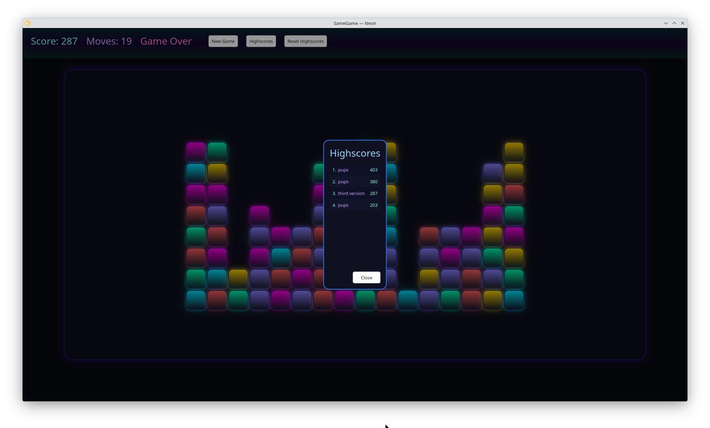

# Tapocalypse

Tapocalypse is a Qt 6 puzzle game built with QML for the UI and C++ for the gameplay, persistence, and testable controller logic. The game takes the core idea of SameGame and presents it with a brighter arcade-style desktop UI, animated tile movement, idle hints, and a local developer pipeline.

Repository:
[https://github.com/marcelpetrick/TapocalypseNow_QmlSameGame](https://github.com/marcelpetrick/TapocalypseNow_QmlSameGame)

**Author: Marcel Petrick <mail@marcelpetrick.it>**

**Note: projected is generated with AI.**

**License: GPLv3 or later. See `LICENSE`.**

## Current State



## Gameplay

Tapocalypse is a tile-clearing game played on a rectangular color grid.

Rules in the current implementation:

- Clicking a tile removes its connected color group using 4-neighborhood adjacency.
- A move is only valid when the group size is at least `3`.
- Score for a move is `groupSize * groupSize`.
- After a valid move, tiles fall downward and empty columns shift left.
- The game ends when no valid group of size `3` or larger remains.
- There is no extra end-game bonus.

UI behavior:

- Hovering tiles highlights their selectable group.
- After three seconds without a click, the game flashes a playable group as an idle hint.
- The hint repeats with a flash-pause-flash cycle until the next click anywhere in the window.

## Features

- Qt Quick / QML desktop UI with animated tile removal, falling, shifting, and hover feedback.
- `GameBoardController` C++ controller that keeps board state, move staging, scoring, and hint timing out of the QML rendering layer.
- `GameRules` pure logic layer for group selection, board collapse, and move planning.
- Persistent top-10 highscores stored as JSON.
- Local test suite covering rules, controller behavior, bridge conversions, and highscore persistence.
- Local pipeline helper that builds, tests, lints, formats, and generates a coverage dashboard.

## Architecture

The project is split into focused layers:

- `qml/` contains rendering, window layout, and interaction wiring.
- `GameBoardController` exposes board state and animation phases to QML.
- `GameRules` contains pure board logic that is unit tested directly.
- `GameLogicBridge` exposes variant-based rule helpers for QML-friendly use and focused tests.
- `HighScoreManager` handles score qualification, storage, sorting, and reset behavior.

This is no longer a “logic in one QML item” prototype. The gameplay path is intentionally structured so visual changes and gameplay changes can be tested independently.

## Build And Run

### Requirements

- Qt `6.5+` with at least `Gui`, `Quick`, `Qml`, and `Test`
- CMake `3.24+`
- A C++20-capable compiler
- A supported build tool such as Ninja or Make

The top-level `CMakeLists.txt`:

- builds the application target `Tapocalypse`
- produces the runtime binary `build/bin/tapocalypse`
- registers the QML module `Tapocalypse 1.0`
- builds a shared `TapocalypseCore` library used by the app and tests
- optionally enables gcov/gcovr-based coverage instrumentation

### Quick Start

Linux or macOS:

```bash
cmake -S . -B build -G Ninja \
  -DCMAKE_BUILD_TYPE=Release \
  -DCMAKE_PREFIX_PATH=/path/to/Qt/6.8.0/gcc_64
cmake --build build
./build/bin/tapocalypse
```

Windows with MSVC and Ninja:

```bat
cmake -S . -B build -G Ninja ^
  -DCMAKE_BUILD_TYPE=Release ^
  -DCMAKE_PREFIX_PATH=C:\Qt\6.8.0\msvc2022_64
cmake --build build
build\bin\tapocalypse.exe
```

If you use Qt Creator, open `CMakeLists.txt`, select a Qt 6 kit, build, and run.

## Local Pipeline

The repository ships a helper script:

```bash
./localPipeline.sh
```

Useful variants:

```bash
./localPipeline.sh --noRun
./localPipeline.sh --build-type Release
./localPipeline.sh --generator Ninja --cmake-arg -DCMAKE_PREFIX_PATH=/path/to/Qt/6.8.0/gcc_64
```

What it does:

- configures and builds the default tree
- runs the registered `CTest` suite
- configures and builds a dedicated `build-coverage/` tree
- generates coverage reports in `build-coverage/coverage/`
- writes an HTML dashboard to `build-coverage/coverage/html/index.html`
- prints total line, function, and branch coverage in the summary
- runs discovered `qmllint` targets when present
- runs `clang-format` on C++ sources when installed
- runs `qmlformat` on QML files when installed
- optionally launches the app as the final step

Current local coverage target:

- lines: `100.0%`
- functions: `100.0%`
- branches: `100.0%`

Notes:

- `xdg-open` or `open` is used to hand the coverage dashboard to the desktop when possible.
- In headless environments the open step may warn even though coverage generation succeeded.

## Tests

The codebase includes Qt Test coverage for:

- `GameRules`
- `GameBoardController`
- `GameLogicBridge`
- `HighScoreManager`

Typical manual run:

```bash
cmake -S . -B build -DCMAKE_BUILD_TYPE=Debug
cmake --build build
ctest --test-dir build --output-on-failure
```

Coverage-enabled run:

```bash
cmake -S . -B build-coverage -DCMAKE_BUILD_TYPE=Debug -DTAPOCALYPSE_ENABLE_COVERAGE=ON
cmake --build build-coverage
ctest --test-dir build-coverage --output-on-failure
cmake --build build-coverage --target coverage
cmake --build build-coverage --target coverage-html
```

## Highscore Storage

Highscores are stored as `highscores.json` under `QStandardPaths::AppDataLocation`.

Typical locations:

- Linux: `~/.local/share/<app>/highscores.json`
- macOS: `~/Library/Application Support/<app>/highscores.json`
- Windows: `%AppData%\<Company>\<App>\highscores.json`

Behavior:

- top 10 entries are kept
- higher score sorts first
- ties are ordered by older timestamp first
- names are trimmed and capped at 20 characters
- non-positive scores are ignored

Reset highscores either from the app UI or by deleting the file while the app is closed.

## Customization

- Grid size: adjust the controller usage in `qml/main.qml`
- Visual style: tweak colors, tile effects, and layout in `qml/`
- Rules and scoring: update `src/GameRules.*` and controller behavior in `src/GameBoardController.*`
- Highscore capacity: change `kMaxEntries` in `src/HighScoreManager.h`

## Project Layout

```text
.
├─ CMakeLists.txt
├─ localPipeline.sh
├─ qml/
│  ├─ main.qml
│  ├─ GameBoard.qml
│  ├─ Tile.qml
│  └─ ScoreDialog.qml
├─ src/
│  ├─ main.cpp
│  ├─ GameBoardController.h/.cpp
│  ├─ GameLogicBridge.h/.cpp
│  ├─ GameRules.h/.cpp
│  └─ HighScoreManager.h/.cpp
└─ tests/
   ├─ test_gameboardcontroller.cpp
   ├─ test_gamelogicbridge.cpp
   ├─ test_gamerules.cpp
   └─ test_highscoremanager.cpp
```

## License

GPLv3. See [LICENSE](LICENSE).

## Credits

Tapocalypse by Marcel Petrick.
