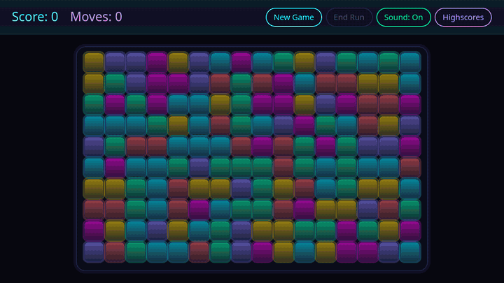
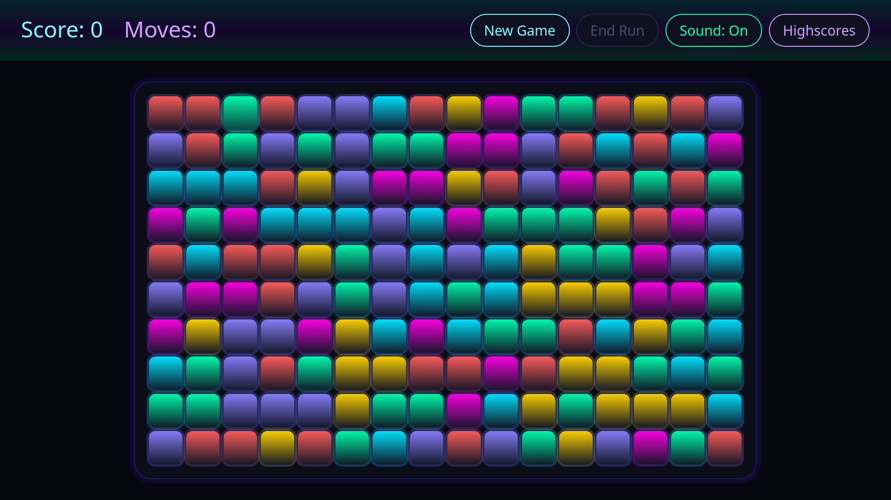
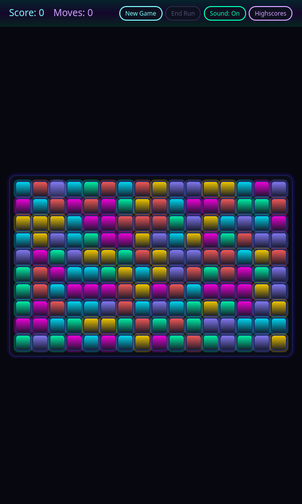
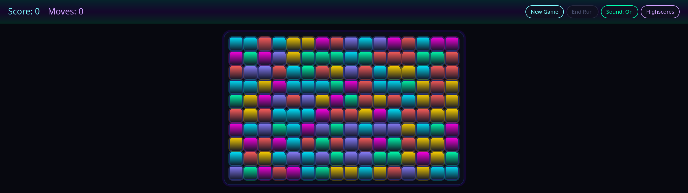

# Tapocalypse

**One click. Whole groups vanish. The board collapses. How far can you take it?**

Tapocalypse is a neon arcade take on the classic SameGame: clear groups of three or more matching tiles, watch the
board fall and slide into new combinations, and chase a score that grows with the *square* of every group you pop.
Small groups are safe. Big groups are glorious — you can *hear* it: every pop climbs a synth arpeggio that gets
longer and higher the bigger the group. Greed is rewarded — until the board locks up.

[](media/gameplay.mp4)

[**Download for Linux, Windows or macOS**](https://github.com/marcelpetrick/TapocalypseNow_QmlSameGame/releases/latest) ·
[Rules](RULES.md) · Build from source: see below

---

## Quick reference card

| | |
|---|---|
| **Goal** | Highest score before no group of 3+ is left |
| **Click** | A tile in a group of **3 or more** same-coloured, edge-touching tiles removes the whole group |
| **Score** | Group of *N* tiles = **N × N** points (3 → 9, 5 → 25, 10 → 100) |
| **Gravity** | Tiles fall down; empty columns close up to the left |
| **Hover** | Outlines exactly the group a click would clear |
| **Stuck?** | Wait 3 s — a playable group flashes as a hint |
| **New Game** | Fresh board, score 0 |
| **End Run** | Bank your current score now and enter the highscores |
| **Highscores** | Local top ten |
| **Sound** | **Sound** button or **M** toggles it; the choice is remembered · `--mute` for one silent session |
| **Window** | Starts full screen · `tapocalypse --windowed` for a resizable window |

**Pro tip:** don't clear the first group you see. Let colours pile up, then take them in one huge move —
a single 12-tile group (144 points) beats four 3-tile groups (36 points) by a factor of four.

## Get it

1. Open the [latest release](https://github.com/marcelpetrick/TapocalypseNow_QmlSameGame/releases/latest).
2. Download the archive for your system and unpack it.
3. Start it:
   - Linux x86_64: `bin/tapocalypse` (native on Wayland and on X11)
   - Windows x86_64: `bin\tapocalypse.exe`
   - macOS (Apple silicon): `tapocalypse.app` — unsigned, so right-click → **Open** the first time.

Everything Qt needs is in the archive. Checksums are in `SHA256SUMS.txt`.

## What you get

- **Crisp neon board** that fills any screen — laptop, 4K, ultrawide, portrait — and stays sharp on resize.
- **Readable motion:** groups pulse and pop, tiles fall, columns slide; nothing teleports.
- **Retro synth sound:** bubbly pops that grow with the group, a cartoon "nuh-uh" for groups that are too small, a
  thud when tiles land, a power-down at game over and a fanfare for a new highscore. All of it is synthesized by a
  script in this repo, so it's free of licences and downloads.
- **Hover preview and idle hints** so you always know what a click will do.
- **End Run** to cash out a good board instead of grinding it down.
- **Local top-ten highscores**, saved safely (atomic writes — a crash never wipes your table).
- **Runs on small hardware:** tuned to hold frame rate on an i.MX8M Mini board.

| Full HD | Portrait | Ultrawide |
|---|---|---|
|  |  |  |

The full, normative rules live in [RULES.md](RULES.md).

## Build from source

**Preflight checklist**

- [ ] Qt **6.5 or newer** with Qt Quick (`qtbase`, `qtdeclarative`) — CI builds 6.5.3 and 6.12.0
- [ ] Qt Multimedia (`qtmultimedia`) for sound — optional: without it, or with `-DTAPOCALYPSE_SOUND=OFF`, the game
      builds and plays silently (handy for embedded images)
- [ ] CMake **3.24+**, a C++20 compiler (GCC, Clang or MSVC), Ninja or Make
- [ ] Optional for the full pipeline: `gcovr`, `doxygen`, `clang-format`, `qmlformat`

**Build, test, play**

```bash
cmake -S . -B build -G Ninja -DCMAKE_BUILD_TYPE=Release -DCMAKE_PREFIX_PATH=/path/to/Qt/6.12.0/gcc_64
cmake --build build
ctest --test-dir build --output-on-failure
./build/bin/tapocalypse --windowed
```

On Windows use `-DCMAKE_PREFIX_PATH=C:\Qt\6.12.0\msvc2022_64` and run `build\bin\tapocalypse.exe`. In Qt Creator,
open `CMakeLists.txt`, pick a Qt 6 kit and run.

**Self-contained install** (Qt libraries, plugins and QML bundled):

```bash
cmake -S . -B build -DCMAKE_BUILD_TYPE=Release -DTAPOCALYPSE_DEPLOY_QT=ON
cmake --build build --config Release
cmake --install build --config Release --prefix dist
```

`TAPOCALYPSE_DEPLOY_QT` is on by default for Windows and macOS and off on Linux, where distribution Qt is shared.
On Linux it bundles both the X11 (`xcb`) and the Wayland platform plugins.

| CMake option | Default | Effect |
|---|---|---|
| `TAPOCALYPSE_SOUND` | `ON` | play sound through Qt Multimedia; `OFF` builds a silent game without the dependency |
| `TAPOCALYPSE_DEPLOY_QT` | `ON` on Windows/macOS | bundle the Qt runtime on `cmake --install` |
| `TAPOCALYPSE_ENABLE_COVERAGE` | `OFF` | gcov instrumentation for the coverage targets |
| `TAPOCALYPSE_VERSION` | project version | version string reported by the app and bundles |

## Developer procedures

### Local pipeline

```bash
./localPipeline.sh                    # build, test, coverage, docs, lint, format, then launch the game
./localPipeline.sh --noRun --noOpen   # unattended: no game window, no browser tabs
```

| Stage | Passes when |
|---|---|
| Configure + Build | the default tree builds |
| CTest | every registered test passes |
| Coverage + Gate | line coverage ≥ `TAPOCALYPSE_COVERAGE_MIN_LINES` (default 90 %) |
| Doxygen | docs build without warnings |
| QML Lint | `all_qmllint` builds |
| clang-format / qmlformat | no file changes |

Reports: `build-coverage/coverage/html/index.html` and `build-docs/doxygen/html/index.html`.

### Tests

| Suite | Covers |
|---|---|
| `GameRulesTests` | group finding, removal, gravity, column shift, move planning |
| `RulesConformanceTests` | seeded random games checked move by move against RULES.md with a reference model |
| `GameBoardControllerTests` | move staging, scoring, hints, hover preview, End Run |
| `GameLogicBridgeTests` | QVariant wire format |
| `HighScoreManagerTests` | qualification, ordering, atomic persistence |
| `FrameProfilerTests` | frame statistics on a real offscreen window |
| `SoundEffectsTests` | pop tiers, mute persistence, every cue compiled in and decodable |
| `EndToEndTests` | the shipped QML driven by real mouse/key input: play to game over, highscore entry, sound cues and toggle, layouts from 480×360 to 2560×720 |

Save end-to-end screenshots with `TAPOCALYPSE_E2E_SCREENSHOT_DIR=/some/dir ./build/EndToEndTests`.

### Sounds and media

| Task | Command |
|---|---|
| Re-synthesize the sound cues into `sounds/` | `python3 tools/generate_sounds.py` (standard library only, reproducible) |
| Regenerate screenshots, GIF and MP4 in `media/` | `tools/make_media.sh` (needs a built tree and `ffmpeg`) |

### Continuous integration and releases

- **CI** (`.github/workflows/ci.yml`): Linux, Windows and macOS with Qt 6.12, Linux with Qt 6.5, and a silent Linux
  build without Qt Multimedia.
- **Release** (`.github/workflows/release.yml`): push a tag `vX.Y.Z` → tested, self-contained archives for all three
  platforms on a GitHub release. Each archive is smoke-started with the CI Qt hidden: Linux under both X11 and a
  Wayland-only session, macOS after an ad-hoc re-seal of the bundle. The app and bundles report the tag's version; keep
  `project(... VERSION ...)` in `CMakeLists.txt` in step for local builds.

### Runtime switches

| Switch | Effect |
|---|---|
| `--windowed` | resizable window instead of full screen |
| `--benchmark` | plays automatically, as fast as the animations allow (silent) |
| `--mute` | no sound for this session (the stored sound setting is left alone) |
| `QT_QPA_PLATFORM=xcb` / `wayland` | force X11 or Wayland on Linux; by default Qt follows the session |
| `TAPOCALYPSE_PROFILE=1` | prints one `TAPOCALYPSE_FRAME` line per second (fps, percentiles, budget overruns) |
| `TAPOCALYPSE_PROFILE_SECONDS=N` | with profiling, quit after *N* seconds |

## Troubleshooting

| Symptom | Fix |
|---|---|
| Coverage stage fails with gcov "version"/"stamp mismatch" | Fixed automatically on the next pipeline run; or delete `build-coverage/` |
| `qmlformat` fails on a file | The installed qmlformat rejects `pragma ComponentBehavior`; don't use the pragma |
| `ctest: No module named 'cmake'` | A pip `cmake` shim shadows the real one; call `/usr/bin/ctest` |
| No `console.log` output in Qt Creator | Already forced to stderr; check `QT_FORCE_STDERR_LOGGING` isn't set to `0` |
| No sound | Check the **Sound** button (or press **M**); builds without Qt Multimedia hide the button and stay silent |
| Linux: wrong display backend | Force one with `QT_QPA_PLATFORM=wayland` or `QT_QPA_PLATFORM=xcb` |
| Reset the highscores | Quit the game and delete `highscores.json` (see below) |

## Storage

| File | Linux | macOS | Windows |
|---|---|---|---|
| `highscores.json` (top ten) | `~/.local/share/tapocalypse/` | `~/Library/Application Support/tapocalypse/` | `%AppData%\tapocalypse\` |
| `settings.ini` (sound on/off) | `~/.config/tapocalypse/` | `~/Library/Preferences/tapocalypse/` | `%LocalAppData%\tapocalypse\` |

## Architecture

| Part | Role |
|---|---|
| `src/GameRules.*` | pure board logic, no Qt GUI dependency |
| `src/GameBoardController.*` | game state, move staging, hints and hover for QML (`QML_ELEMENT`) |
| `src/VariantConversions.h` | the QVariant wire format shared with QML |
| `src/GameLogicBridge.*` | variant-based access to the rules for scripting and tests |
| `src/HighScoreManager.*` | top-ten table with atomic JSON persistence |
| `src/SoundEffects.*` | cue player and persistent mute switch; silent without Qt Multimedia |
| `src/FrameProfiler.*` | opt-in frame-time telemetry |
| `qml/` | window, board, tiles, dialog, themed buttons — rendering only |

```text
.
├─ CMakeLists.txt        build, tests, coverage, install/deploy
├─ localPipeline.sh      local quality gate
├─ RULES.md              normative game rules
├─ src/                  C++ core and controller
├─ qml/                  QML user interface
├─ sounds/               synthesized WAV cues (generated)
├─ media/                README screenshots and GIF (generated)
├─ tools/                sound synthesizer, media generator
├─ tests/                Qt Test suites, incl. end-to-end
└─ .github/workflows/    CI and release
```

## License

GPLv3 or later — see [LICENSE](LICENSE).

## Credits

Tapocalypse by Marcel Petrick &lt;mail@marcelpetrick.it&gt;. This project is generated with AI.
